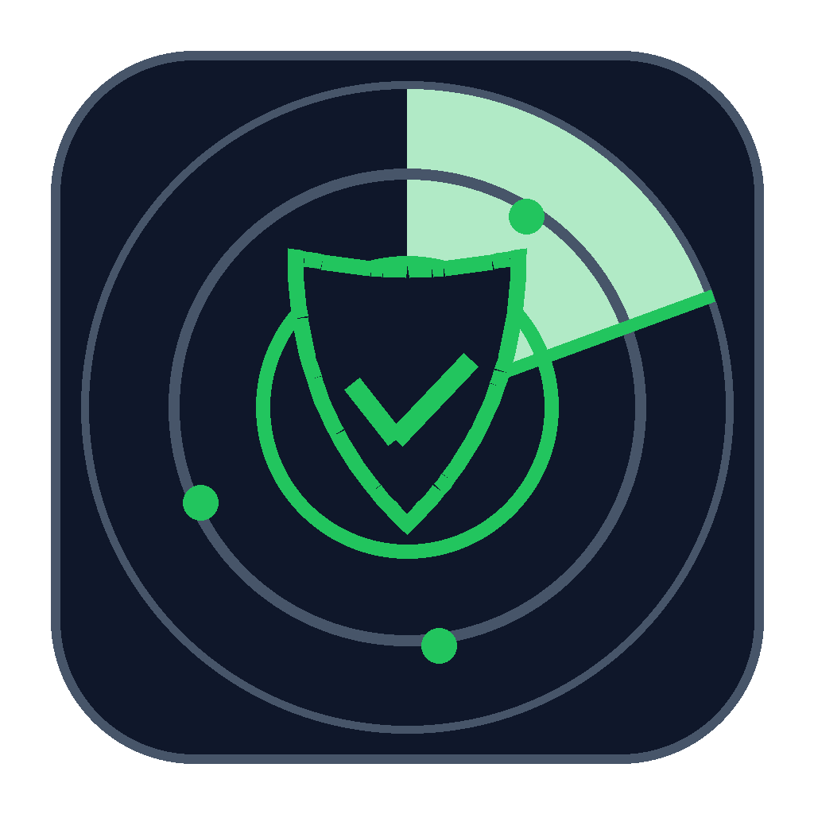

<div align="center">



# Cairnwatch

**Track the releases of the GitHub and GitLab projects you follow, and scan every download on VirusTotal before it touches your disk.**

[](LICENSE)

[](https://github.com/stavros-it/cairnwatch/releases/latest)
[](https://github.com/stavros-it/cairnwatch/releases)


</div>

Cairnwatch is a small, portable desktop app for Windows and Linux. Paste the URL of a
GitHub or GitLab repo, hit **Refresh**, and see which projects have a new
release. When you download a release asset, Cairnwatch checks it on
VirusTotal first and only delivers it to your download folder once it has a
verdict you accept. It never installs anything. You run the files yourself.

## Features

- **Follow any repo** on GitHub, gitlab.com or a self-hosted GitLab, by pasting its URL. No account sync.
- **See what's new**: a NEW marker on repos whose latest release changed since you last looked, with release notes and an asset table.
- **Mark your installed version** per repo, and get an "update available" tag when a newer release appears.
- **VirusTotal download gate**: every asset is hashed and looked up on VirusTotal. Unknown files are uploaded for analysis (optional). Clean files are delivered automatically; flagged or unscanned files raise a blocking dialog where **Cancel is the default**.
- **Per-repo filters**: include prereleases, tag regex, and an asset glob (for example `*-x86_64.zip`) that sorts matching assets first.
- **Search, sort, pin and categorise** your list.
- **Rate-limit and statistics views**, plus an in-memory log with local timestamps.
- **Portable**: one exe on Windows, one AppImage on Linux. Config and data live next to it. No installer, no registry.
- **Private**: manual refresh only, no background polling, no telemetry. The only network calls go to the GitHub, GitLab and VirusTotal APIs.
- **Keys kept safe**: API keys live in Windows Credential Manager (or the Secret Service keyring on Linux), never in `config.toml` or a plain export.

## Getting started

1. Download from the [Releases](https://github.com/stavros-it/cairnwatch/releases) page, or [build it yourself](#build-from-source):
   - **Windows**: `cairnwatch-<version>-windows.zip`, unzip and run `cairnwatch.exe`.
   - **Linux**: `Cairnwatch-<version>-x86_64.AppImage`, then `chmod +x` it and run it.
2. Put it in its own folder and start it. It creates `config.toml`, `repos.json`, `tmp/` and `downloads/` next to the exe (or next to the `.AppImage` on Linux).
3. Open **Settings** and add:
   - a **VirusTotal API key** (free at [virustotal.com](https://www.virustotal.com)). Without one, every download asks "Not scanned, proceed?" with Cancel as the default.
   - optionally a **GitHub token** to raise the limit from 60 to 5000 requests per hour, and a GitLab token.
4. Click **+ Add repo**, paste a repository URL, then **Refresh**.

## How the download gate works

```
Download → hash (SHA-256) → VirusTotal lookup ─┬─ known & clean ──→ delivered
                                               ├─ known & flagged ─→ blocking dialog (Cancel default)
                                               └─ unknown ─→ upload & wait ─→ verdict ─→ as above
                                                    └─ no key / failed ─→ "Not scanned, proceed?" dialog
```

Downloads go to a temp folder first. A file reaches your download folder
only after a clean verdict or your explicit confirmation. Uploads to
VirusTotal are streamed from disk, so large files do not fill your memory.

## Where your keys live

The VirusTotal key and the GitHub and GitLab tokens are stored in **Windows
Credential Manager** (entries named `vt_api_key.GiRustStatus`,
`github_pat.GiRustStatus` and `gitlab_pat.GiRustStatus`; the service name
keeps the app's original name so existing installs keep their keys). This
is the one thing stored outside the app folder, so keys do **not** travel
with the folder.

On Linux the same entries go to the **Secret Service** keyring (GNOME
Keyring, KWallet) over D-Bus, so a keyring daemon must be running.

## Moving to another PC

1. Settings, **Export (encrypted, with keys…)**, choose a password. This writes `cairnwatch-export.enc` next to the exe.
2. Copy the folder to the new PC.
3. Settings, **Import…**, enter the password. Repos, state and keys come across.

The plain export contains no keys. Delete the `.enc` file once imported.

## Build from source

You need a recent stable [Rust toolchain](https://rustup.rs).

```sh
cargo test
cargo build --release   # output: target/release/cairnwatch(.exe)
```

Linux AppImage (x86_64; needs `build-essential pkg-config curl file libxkbcommon-dev libwayland-dev libgl1-mesa-dev`):

```sh
packaging/linux/build-appimage.sh   # output: dist/Cairnwatch-<version>-x86_64.AppImage
```

Built with [egui](https://github.com/emilk/egui)/eframe and rustls. Windows is the primary platform; Linux is supported via AppImage.

## Inspiration

Cairnwatch is inspired by [Obtainium Plus](https://github.com/thejaustin/ObtainiumPlus),
a fork of [Obtainium](https://github.com/ImranR98/Obtainium) for Android,
which fetches app updates straight from their developers. Cairnwatch brings
that idea to the desktop and adds a VirusTotal gate in front of
every download. It shares no code with either project.

## License

[MIT](LICENSE) © 2026 stavros-it
